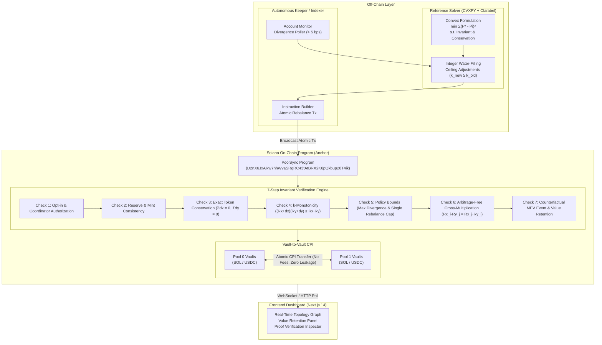

# PoolSync: Atomic Multi-Pool AMM Rebalancing on Solana

> **Research Prototype:** This software is an experimental implementation developed for algorithmic validation and research purposes on Solana Localnet and Devnet. It has **not been audited** and is **not intended for production mainnet use**.

PoolSync is an atomic multi-pool constant-product Automated Market Maker (AMM) engine implemented on Solana using the Anchor framework. It eliminates price divergence across multiple AMM pools sharing the same asset pair through atomic, off-market token reallocation—retaining **100% of counterfactual arbitrage value for Liquidity Providers (LPs)** rather than losing it to external MEV searchers.

---

## Architecture Overview



---

## Key Features

1. **Atomic Multi-Pool Rebalancing:** Reallocates reserves across $N$ pools in a single transaction using direct Cross-Program Invocations (CPI) between SPL Token vaults. No external swaps, no slippage, and zero swap fees charged between participating pools.
2. **100% LP Value Retention:** In traditional AMMs, inter-pool price divergence is extracted by external MEV arbitrage bots who buy from the underpriced pool and sell to the overpriced pool, draining reserves from LPs. PoolSync internalizes this spread: the reserves shift directly between vaults, capturing 100% of the counterfactual arbitrage profit for the pool vaults.
3. **Rigorous On-Chain Invariant Engine:** Guarantees that no pool is ever left worse off:
   - **Check 1 (Opt-in & Coordinator):** Only pools that explicitly opt in with an authorized coordinator PDA can be rebalanced.
   - **Check 2 (Reserve Consistency):** On-chain vault accounts must strictly match the pool state and mint pairs.
   - **Check 3 (Conservation):** Net sum of transfers across all participating pools must strictly equal zero ($\sum dx_i = 0$ and $\sum dy_i = 0$). External deposits or withdrawals are rejected.
   - **Check 4 ($k$-Monotonicity):** Every pool's invariant must satisfy $k_{\text{post}} \ge k_{\text{pre}}$. Enforced down to the exact single raw integer lamport.
   - **Check 5 (Policy Bounds):** Transfers must respect governance policy bounds (e.g. max single rebalance cap of 2,000 bps, divergence thresholds).
   - **Check 6 (Arbitrage-Free Convergence):** Rebalanced marginal spot prices must equalize across all pools in the pool-family via cross-multiplication: $R_{x,i} R_{y,j} = R_{x,j} R_{y,i}$.
   - **Check 7 (Counterfactual MEV Event):** Emits an on-chain event calculating the exact profit an external bot would have extracted, proving 100% value retention.
4. **Convex Reference Solver:** Python reference solver formulated in CVXPY with the Clarabel interior-point solver, augmented with an exact integer water-filling projection algorithm that guarantees single-lamport $k$-monotonicity.
5. **Interactive Observability Dashboard:** Built with Next.js 14 App Router, Tailwind CSS, Lucide icons, and an on-chain proof verification inspector.

---

## Benchmark Results: Value Retention (Vector 4)

| Metric | Status Quo (External MEV Bot) | PoolSync (Atomic Rebalance) | Difference / LP Benefit |
| :--- | :--- | :--- | :--- |
| **Pool 0 Initial Price** | 100.00 USDC / SOL | 100.00 USDC / SOL | Identical |
| **Pool 1 Initial Price** | 105.00 USDC / SOL | 105.00 USDC / SOL | Identical (500 bps spread) |
| **Execution Path** | 2 Sequential AMM Swaps | 1 Atomic Vault CPI Rebalance | Zero external routing |
| **Post-Rebalance Price** | ~102.4848 USDC / SOL | **102.5000 USDC / SOL** | Exact equilibrium (0 bps spread) |
| **Tokens Extracted by MEV** | **$30.49 USDC** | **$0.00 USDC** | **+$30.49 USDC Saved** |
| **LP Invariant Change ($\Delta k$)** | $\Delta k_0 \approx 0, \Delta k_1 \approx 0$ | **$\Delta k_0 > 0, \Delta k_1 > 0$** | Both pools strictly better off |
| **Value Retained by AMM LPs** | 0.00% | **100.00%** | **+100.00% Retained** |

---

## Quickstart

### Prerequisites
- Node.js v20+ and npm
- Rust & Cargo (1.79+)
- Solana CLI (1.18+)
- Anchor CLI (0.30.1)
- Python 3.10+ with `cvxpy`, `clarabel`, `numpy`, and `pytest`

### 1. Run Complete Test Suite (Phases 0–3)

Run the automated test runner in WSL or Linux:

```bash
bash scripts/run_tests.sh
```

This runs:
- **Phase 0:** 30 unit, property-based (Hypothesis), and regression tests for the reference solver and arbitrage bot.
- **Phase 1:** Core AMM on-chain program tests (initialization, add/remove liquidity, fee calculation, invariant swaps).
- **Phase 2:** Multi-pool atomic rebalance tests (Vector 4 on-chain reproduction, all 7 negative invariant rejection tests).
- **Phase 3:** Keeper service, baseline arbitrage bot, dry-run mode, and equilibrium confirmation tests.

### 2. Standalone Invariant Auditor

Run the standalone verification script that mathematically audits a rebalance transaction:

```bash
npx tsx scripts/verify_rebalance.ts
```

### 3. Launch Interactive Dashboard

```bash
cd dashboard
npm install
npm run dev
```

Open [http://localhost:3000](http://localhost:3000) in your browser:
- Monitor live constant-product pool reserves.
- Click **"Trigger Atomic Rebalance"** to eliminate inter-pool divergence down to 0.0000 bps.
- View real-time directed transfer flows ($12.27$ SOL $\to$, $\$1,242.38$ USDC $\leftarrow$).
- Inspect the mathematical proof in the Rebalance Ledger verifying all 7 invariants.
- Click **"Simulate 500 bps Price Shock"** to reset and test the workflow again.

---

## Repository Structure

```
├── programs/
│   └── pool_sync/           # Anchor program: core AMM + multi-pool rebalancing
│       ├── src/
│       │   ├── lib.rs       # Entrypoint & program instructions
│       │   ├── state.rs     # Pool, Policy, and Invariant account definitions
│       │   ├── rebalance.rs # 7-check atomic rebalance execution engine
│       │   └── errors.rs    # Custom program error codes
├── solver/
│   ├── solver.py            # Reference convex solver & integer water-filling
│   ├── arb_bot.py           # Baseline arbitrage bot & value comparison
│   ├── keeper.py            # Python reference keeper service
│   └── tests/               # 30 Phase 0 unit & property tests
├── scripts/
│   ├── keeper.ts            # Autonomous TypeScript keeper service
│   ├── verify_rebalance.ts  # Standalone invariant auditor
│   ├── setup_devnet.ts      # Devnet mints & pool bootstrap script
│   ├── deploy_devnet.sh     # Devnet deployment pipeline
│   └── run_tests.sh         # One-command full test orchestrator
├── dashboard/               # Next.js 14 App Router dashboard & API routes
│   ├── src/app/             # Pages and API endpoints (/api/pools, /api/rebalance, /api/verify)
│   ├── src/components/      # UI components (OpportunityBanner, PoolCard, TransferGraph, etc.)
│   └── test_dashboard.mjs   # End-to-end integration test runner
└── tests/                   # Integration test suites for Anchor
    ├── pool_sync.ts         # Phase 1: Core AMM tests
    ├── rebalance.ts         # Phase 2: Atomic rebalance & 7 negative tests
    └── keeper.ts            # Phase 3: Keeper & value retention tests
```

---

## Theoretical Foundations: What the Model Proves and What it Does Not

### What the Model Proves
1. **Pareto Dominance over External Arbitrage:** When inter-pool price divergence exists within a closed set of pools sharing identical assets, direct vault-to-vault reallocation captures 100% of the price gap surplus for the AMM reserves. External searchers extract this surplus as MEV; PoolSync retains it within the pools.
2. **Strict $k$-Monotonicity:** Under the convex water-filling formulation with integer ceiling adjustments, no participating pool suffers a decrease in its constant-product invariant ($k_{\text{post}} \ge k_{\text{pre}}$). LPs are strictly non-worse off.
3. **Equilibrium Stability:** Equalizing marginal spot prices ($R_{y,i} / R_{x,i} = R_{y,j} / R_{x,j}$) eliminates all two-point arbitrage opportunities between the participating pools.

### What the Model Does Not Prove (Limitations & Boundaries)
1. **Loss-Versus-Rebalancing (LVR) vs External Markets:** PoolSync harmonizes prices *between internal pools*. If the global external reference price (e.g., on Binance or Pyth) moves, rebalancing internal pools to each other does not eliminate overall LVR against the wider market; it only prevents internal inter-pool arbitrage leakage.
2. **Dynamic Volatility & Order Flow:** The model assumes an instantaneous state transition. In high-frequency environments, intervening user swaps during transaction submission may alter reserves before execution, necessitating strict slip-tolerance or slot-bounded execution.
3. **Non-Uniform Fee Tiers:** When pools possess disparate fee tiers (e.g. 5 bps vs 30 bps), the no-arbitrage condition becomes a band rather than a point; rebalancing within this band must account for fee-adjusted marginal rates.

---

## Security & Risk Notice

- **Not Audited:** This codebase has not undergone a formal security audit. Do NOT use with real funds on Solana Mainnet-Beta.
- **Localnet & Devnet Only:** Keypairs generated during testing are throwaway keys and must never be funded with mainnet SOL.
- **Threat Model:** For a detailed breakdown of threat vectors (compromised coordinator, front-running, sandwich attacks, and discretization errors) and our multi-layered mitigations, please read [THREAT_MODEL.md](THREAT_MODEL.md).

---

## License

Apache License 2.0. See [LICENSE](LICENSE) for details.
